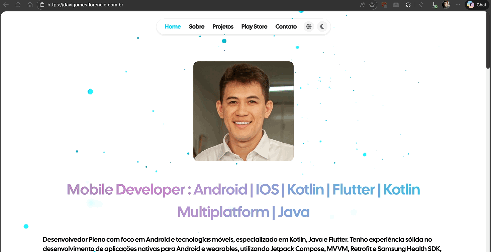

<div>

</div>

# Portfólio - Davi Gomes Florencio

Portfólio pessoal de **Davi Gomes Florencio**, desenvolvedor mobile (Android, Kotlin, Jetpack Compose, Flutter e Wear OS). Reúne experiência profissional, formação, projetos open source e os apps publicados na Google Play.

🌐 **https://davigomesflorencio.com.br**

---

## 🚀 Tecnologias

- **[React 19](https://react.dev/)** + **[TypeScript](https://www.typescriptlang.org/)**
- **[Vite 7](https://vitejs.dev/)**: dev server e build de produção
- **[Tailwind CSS v4](https://tailwindcss.com/)**: configuração _CSS-first_ em `src/index.css`
- **[React Router v6](https://reactrouter.com/)**: SPA com cada página carregada sob demanda (`React.lazy`)
- **[i18next](https://www.i18next.com/)**: português e inglês, com detecção automática do idioma
- **[Leaflet](https://leafletjs.com/)**: mapa da página Sobre
- **[EmailJS](https://www.emailjs.com/)**: formulário de contato
- **[OGL](https://github.com/oframe/ogl)**: fundo de partículas em WebGL
- **[FontAwesome](https://fontawesome.com/)**: ícones
- **[react-ga4](https://github.com/codler/react-ga4)**: Google Analytics 4, carregado só depois da primeira interação

As animações (fade, texto em gradiente, card inclinado) são feitas com CSS e eventos do navegador, sem bibliotecas de animação.

---

## 📄 Páginas

| Rota | Página |
|---|---|
| `/` | Home: apresentação, tecnologias, experiências e formação |
| `/about` | Sobre: trajetória, mapa e stacks |
| `/projects` | Projetos do GitHub |
| `/playstore` | Apps publicados na Google Play |
| `/screenshot` | Screenshot Gnix (app + política de privacidade) |
| `/scanner-mlkit` | Scanner MLKIT (app + política de privacidade) |
| `/facedetector-mlkit` | Face Detector DF MLKit (app + política de privacidade) |
| `/contact` | Contato |

---

## 🏃 Como executar

Requisitos: **Node.js 20.19+** (ou 22.12+) e npm.

```bash
git clone https://github.com/davigomesflorencio/portifolio-react-vite.git
cd portifolio-react-vite
npm install
npm run dev
```

### Variáveis de ambiente

O formulário de contato usa o EmailJS. Crie um arquivo `.env` na raiz (ele já está no `.gitignore`):

```env
VITE_EMAILJS_SERVICE_ID=...
VITE_EMAILJS_TEMPLATE_ID=...
VITE_EMAILJS_PUBLIC_KEY=...
```

Sem essas variáveis o site funciona normalmente; só o envio do formulário falha.

### Scripts

| Comando | O que faz |
|---|---|
| `npm run dev` | Servidor de desenvolvimento |
| `npm run build` | Checagem de tipos (`tsc -b`) + build de produção em `dist/` |
| `npm run preview` | Serve o build de `dist/` localmente |
| `npm run lint` | ESLint |
| `npm run check` | Verifica o build (SEO, tamanho do JS, rotas, imagens). Rode depois do `build` |
| `npm run check:render` | O mesmo, abrindo cada rota no Chrome headless |
| `node scripts/optimize-images.mjs` | Converte PNG/JPG de `public/` para WebP e normaliza os nomes |

---

## 📂 Estrutura

```
├── .github/workflows/
│   ├── pr-checks.yml           # build + checagens em cada PR
│   └── deploy-vite-react.yml   # deploy no push para a main
├── fonts/                      # Cal Sans (WOFF2)
├── public/                     # imagens (WebP), robots.txt, sitemap.xml, llms.txt, currículo
├── scripts/
│   ├── check-build.mjs         # checagens do build (usado no CI)
│   └── optimize-images.mjs     # conversão de imagens para WebP
├── src/
│   ├── components/             # about, common, contact, homepage, playstore, projects
│   ├── data/user.ts            # todo o conteúdo: experiências, formação, projetos, apps
│   ├── locales/{pt,en}/        # traduções, incluindo títulos e descrições de SEO
│   ├── pages/                  # uma página por rota
│   ├── App.tsx                 # rotas
│   └── i18n.ts
└── index.html                  # meta tags, JSON-LD e conteúdo inicial para crawlers
```

---

## ✏️ Como atualizar o conteúdo

- **Experiências, formação, projetos e apps:** edite `src/data/user.ts`.
- **Textos da interface:** edite `src/locales/pt/translation.json` e `src/locales/en/translation.json`.
- **Imagens:** sirva sempre de `public/`, nunca por link de outro site (links do LinkedIn expiram e o Google bloqueia hotlink da Play Store). Coloque o PNG/JPG em `public/` e rode `node scripts/optimize-images.mjs`.

### Criando uma página nova

1. Crie o componente em `src/pages/` e a rota em `src/App.tsx` com `lazy(() => import(...))`.
2. Chame `useSeo(título, descrição, caminho)` e use **um único** `<h1>`.
3. Adicione os textos de SEO na seção `seo` das traduções.
4. Inclua a rota em `public/sitemap.xml` e em `public/llms.txt`. O CI falha se faltar.

---

## 🔍 SEO e performance

- **SEO:** título, description e canonical por rota; Open Graph; dados estruturados (JSON-LD `Person`); `robots.txt`, `sitemap.xml` e [`llms.txt`](https://davigomesflorencio.com.br/llms.txt); conteúdo inicial com H1 e links no `index.html` para crawlers que não executam JavaScript.
- **Performance:**
  - code splitting por rota;
  - imagens em WebP com `width`/`height` e lazy loading;
  - fonte em WOFF2 com `font-display: swap`, preload e fallback com métricas ajustadas (evita troca de layout);
  - Google Analytics carregado só após a primeira interação.

> Ao mexer no conteúdo inicial do `index.html`, use `padding` (e não `margin`) no topo: a margem colapsa com a do `body` e causa troca de layout (CLS).

---

## ⚙️ CI/CD

- **Em cada PR** (`pr-checks.yml`): `npm ci`, `npm run build` e `npm run check:render`. O check se chama **"Build e checagens"**.
- **Branch `main` protegida:** merge só via PR com o check passando; force push e exclusão bloqueados.
- **Deploy** (`deploy-vite-react.yml`): a cada push na `main`, o build é enviado por SSH para o servidor (Nginx em VPS) e o site é verificado.

---

## 👤 Autor

**Davi Gomes Florencio**

- [Site](https://davigomesflorencio.com.br)
- [GitHub](https://github.com/davigomesflorencio)
- [LinkedIn](https://www.linkedin.com/in/davi-g-883b7a12a/)
- [Instagram](https://instagram.com/davi.kts)
